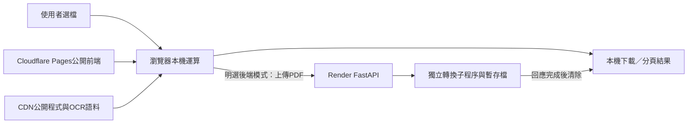

# 博申轉檔平台技術、安全設計與限制

## 文件基本資料

| 欄位 | 內容 |
| --- | --- |
| 系統 | 博申轉檔平台 PDF-Convert |
| 文件版次／狀態 | 1.0 草案；待公司審閱核准 |
| 整理日期／時區 | 2026-11-20，Asia/Taipei |
| 原始碼基準 | `d676023e9781757980e2710e172272e364c0b351`；API 0.3.0；前端 PWA v28 |
| 撰寫方式 | 依現有程式、設定與歷史紀錄整理；產製工具 Codex |
| 維護／審閱／核准人 | 公司指定之系統負責人／資訊與使用部門主管／核准人，均待指定 |
| 發布環境 | Cloudflare／Render 正式版次與政策本次未登入核對 |

文件版次不等於產品升版。已實作、歷史已測試、本次已測試、已驗收與待核准分別記錄。本次未執行產品測試、弱點掃描、正式站轉檔測試或公司實機驗收；文件提交可能觸發既有Render自動建置，不作為驗收證據。

## 1. 架構與信任邊界

「本機處理」描述文件運算位置，不代表網站完全無網路。公開前端與CDN供應鏈可影響使用者載入的程式；機密文件允許模式須由公司核准。獨立子程序用於隔離轉換生命週期，不是惡意PDF的完整安全沙箱；原生函式庫與OS仍有攻擊面。

## 2. 資料清冊與保存

| 資料 | 來源／目的 | 位置與清除 | 責任／限制 |
| --- | --- | --- | --- |
| 原PDF／圖片／SVG／TTF | 使用者本機選檔 | 原檔由使用者保管；程式不改寫 | 公司資料主責決定敏感等級與可用模式 |
| OCR文字、縮圖、畫布、標註、結果 | 本機運算 | 分頁記憶體；重選／輸出／頁面離開等生命週期清除 | 不保證瀏覽器／OS記憶體安全抹除 |
| 正式結果Blob URL | 同功能最近一次輸出 | 單份128MiB／合計256MiB；FIFO釋放、手動清除、pagehide | 無固定分鐘數、無歷史下載庫；試轉另有既有預覽暫存 |
| 偏好 | 語言、快速／外觀、API網址、最近色彩 | localStorage；清站台資料可移除 | 不應在API網址放憑證；不是文件／密碼保存 |
| PWA快取 | 公開前端、引擎、OCR語料 | 限sw.js白名單GET；瀏覽器可驅逐 | 文件Blob、POST與API不在快取處理範圍 |
| 後端上傳與轉換結果 | 明選上傳PDF | tempfile目錄，回應傳送後背景rmtree，例外清除 | 異常終止／傳送中斷情境及殘留清除須另驗證；非保證安全覆寫 |
| 後端操作日誌 | 種類、頁數、排隊／轉換耗時、錯誤種類 | 程式不刻意記錄文件內容；供應商接入日誌另核對 | 操作者身份、來源IP、日誌存取／保存期待核定 |
| 已下載結果 | 瀏覽器下載 | 使用者磁碟／公司文件庫 | 不隨網站清除；公司需管理下載資料夾、分享與備份 |

## 3. API介面

後端版本0.3.0，multipart欄位`file`，MIME需application/pdf；沒有內建登入、Bearer驗證、角色或租戶資料模型。

| 方法／路徑 | 參數 | 成功結果／錯誤 |
| --- | --- | --- |
| GET /health | 無 | status ok、version0.3.0；僅服務存活，不證明commit |
| POST /convert/pdf-to-docx | file | DOCX；無文字層422，後端不含OCR |
| POST /convert/pdf-to-xlsx | file | XLSX；目前前端用本機，API仍存在 |
| POST /convert/pdf-to-svg | file；page選填 | 指定頁SVG／全部頁ZIP，頁碼越界400；前端本機功能與此API不同實作 |
| POST /convert/pdf-compress | file；level=screen/ebook/printer | PDF；不符level400，可含大小資訊標頭 |

共通400格式／空檔／保護，413超25MiB，503等候逾30秒，504轉換逾120秒，500引擎失敗。CORS允許所有來源／方法／標頭，僅為瀏覽器跨來源規則，並非身分授權。回應揭露檔名、大小與轉換／排隊計時；不得自動無限重試或將機密原檔投入診斷服務。

## 4. 已實作控制

- AppCore驗證檔頭、頁碼及圖像尺寸；頁面同時一個工作，取消時檢查訊號並釋放引擎／畫布。SVG5MiB、10000物件、引用深度32及工作量限制；TTF20MiB且檢查字形，Shadow DOM隔離來源樣式、結束移除臨時字型；拒絕外部資源、腳本、DTD、循環與不支援元素。
- qpdf在Worker本機執行，處理上限120秒；密碼欄位於完成／失敗／取消等清除。AES-256及權限限制不等於DRM；重新儲存可能使數位簽章失效。
- 後端每份獨立子程序，POSIX逾時終止程序群組；semaphore每個API程序並行1。多個API程序／多實例不共用此鎖；不得據此宣稱全域限流或512MiB硬記憶體限制。
- PWA只快取公開白名單資源，選擇性偏好不包含文件內容；無內建持久業務資料庫。

## 5. 重要界線與補救

| 界線／風險 | 建議補救／監控 | 證據狀態 |
| --- | --- | --- |
| API無登入、全域限流、WAF策略證據 | 公司決定停用／限制後端用途，另核對入口保護、濫用與資源監控 | 待核定／待控制台核對 |
| CDN及原生解析函式庫供應鏈 | 定期SCA、授權檢查、固定版本／雜湊、評估自託管與CSP／SRI | 本次未掃描，未證明所有資源有SRI |
| OCR、字型、背景、表格近似 | 來源比對，重要數值／單位／醫療等內容人工覆核 | 歷史樣本不是全文件正確率保證 |
| 暫存清理非安全抹除，容器崩潰可能留檔 | 制定殘留檢查、事件處理與供應商保留政策 | 待實測／核定 |
| 免費服務冷啟動與瀏覽器驅逐 | 允許重試、先試轉、立即下載，規劃可用性要求 | 本次未測現行服務時間 |
| 無完整操作者稽核／不可變日誌 | 必要時由公司流程留轉檔／覆核證據；不得宣稱完整稽核軌跡 | 待制度決定 |

## 6. 設定、部署、備份與復原

前端部署整份frontend，保留icons；不部署tests、docs、機密樣本及.venv。Render僅Dockerfile COPY的後端程式，PORT由環境提供；requirements固定直接依賴，python基底標籤、OS套件與間接依賴不是完整可重現鎖檔。管理平台MFA、帳號、Token與環境變數權限在外部管理，本文件不記錄秘密值。

備份範圍為Git、經核准部署包／雜湊、環境設定名稱與帳號復原程序。使用者原文件與下載結果由公司文件保存政策管理；網站不提供結果復原。復原步驟與核對門檻見[IT手冊](其他/IT維運與備援手冊.md)。RTO／RPO及保存期未核定，不填入推測數字。

## 7. 驗證與追蹤來源

控制存在的依據為上述原始碼，不等於測試通過或控制台設定已生效。案例／證據見[測試紀錄](系統測試紀錄.md)、[發布清冊](其他/發布與證據識別清冊.md)及[元件紀錄](其他/第三方元件與弱點檢查紀錄.md)。官方維護入口依元件清冊追蹤；本次未查證現行公告或出具第三方資安結論。

## 修訂與審閱紀錄

| 版次 | 日期 | 內容 | 審閱／生效 |
| --- | --- | --- | --- |
| 1.0 草案 | 2026-11-20 | 依公司共用規範建立 PDF-Convert 交付文件 | 待審閱；未核准生效 |
